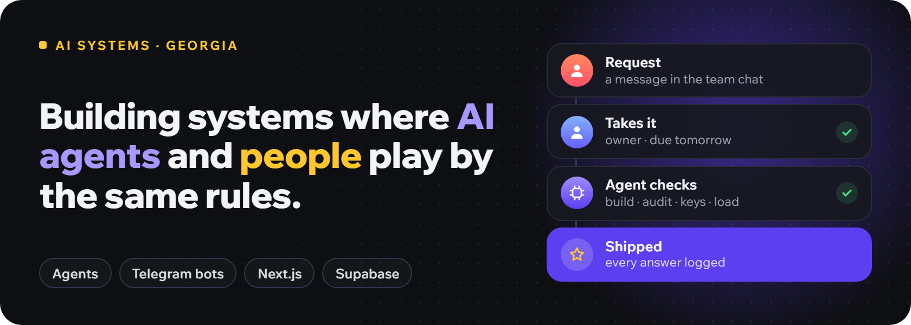
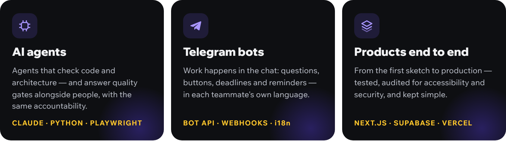

  

  

### How I work

- **Every step has an owner.** A person or an agent answers for it — and the answer is logged, never rewritten.
- **Agents do the checking.** Builds, UI audits, accessibility, secrets, architecture against the expected load.
- **Less is more.** The fewest entities and lines of code that solve the task — no overengineering.

### Stack

  
  
  
  
  
  
  
  
  
  
  

### Contact

